# bonsAI

[](https://github.com/qd313/bonsAI/releases/latest)
[](LICENSE)


**A helper for your Steam Deck that answers questions about your games, using an AI that runs on
your own Deck or your own PC.**

bonsAI lives in the Deck's **Quick Access Menu**, the panel the **`...`** button opens. Press it
mid-game, ask how to beat a boss or why the game stutters and keep playing.

<p align="center">
  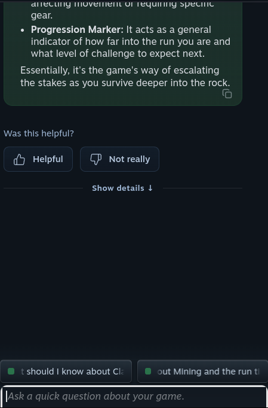
  &nbsp;
  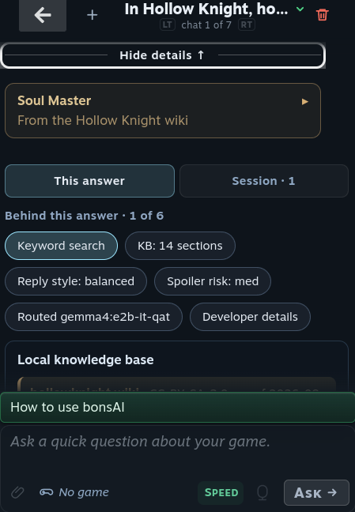
</p>

<!-- toc: written by scripts/docs_toc.py; do not hand-edit -->
**Contents:** [Free, open and yours](#free-open-and-yours) · [What it does](#what-it-does) · [Before you start](#before-you-start) · [What you need](#what-you-need) · [Install](#install) · [Getting help](#getting-help) · [Help build it](#help-build-it) · [License](#license) · [Buy me a beer](#buy-me-a-beer)
<!-- /toc -->

## Free, open and yours

> [!NOTE]
> bonsAI is free and open source. It runs on your own hardware, your privacy stays yours. No paid
> API, no data centers.
>
> - **Your questions stay on your hardware**, on your Deck, on your own PC or wherever you point it.
> - **No account, no cloud service, nothing collected.**
> - **Every line of code is here to read.**

<!-- This list matches the 0.6.0 security review (workshop:audit/security-review-0.6.0.md, 2026-09-28).
     Anything new that reaches the internet must be added here. -->
**What does reach the internet**, so you can check the claim instead of trusting it:

- **Installing Ollama** (the program that runs the AI) **and its models**: from **ollama.com**, which
  hands the program itself over from **GitHub**.
- **The knowledge library**: from **Hugging Face**, with **GitHub** as backup.
- **Voice input**: the speech engine from **GitHub**, the tools to build it from **Ubuntu's servers**
  and the speech model from **Hugging Face**.

Nothing downloads until you switch on **Internet downloads**, on the Permissions tab or when bonsAI
asks, and bonsAI tells you where each download comes from before it starts. Links inside answers open only when you
tap them.

## What it does

Every clip is filmed on a Steam Deck, most with the AI on a PC at home. Waiting is cut out and
each cut fades to black; nothing is sped up.

<dl><dd>

<details>
<summary><b>Ask about your game</b> — <i>it knows which game is running</i></summary>
<br>

Ask about a boss, a level or a puzzle, by typing or with a suggestion chip. Pick a mode: **Speed**
for a quick reply, **Strategy** for coaching, **Expert** for the most detail. Switch on **Thinking**
to watch the steps.

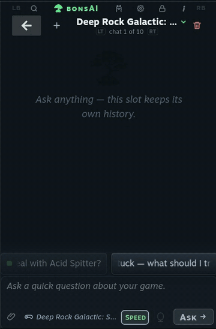

</details>

<details>
<summary><b>Wiki notes</b> — <i>notes from fan wikis for 38 games, offline</i></summary>
<br>

The knowledge library is a one-time download. An answer that uses a note says where it came from,
and you can open the note under the answer.

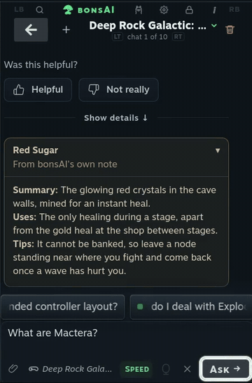

*With the AI on the Deck itself.*

</details>

<details>
<summary><b>Your own notes</b> — <i>tell it what matters and it remembers</i></summary>
<br>

Say something like "no spoilers for later biomes" and a card offers to keep it, for this game or
every game. Later answers say **Read 1 of your notes**; press it to see, switch off or remove a note.

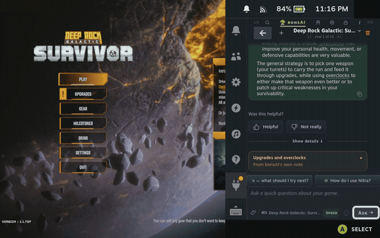

</details>

<details>
<summary><b>Spoiler covers</b> — <i>spoilers stay hidden until you open them</i></summary>
<br>

In Strategy mode, anything that looks like a spoiler is covered; press **A** to open it. It's
best-effort and can miss things.

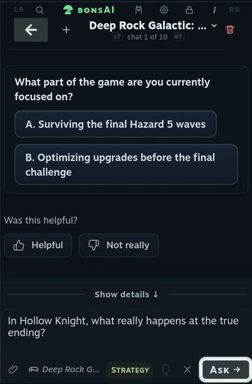

</details>

<details>
<summary><b>Checklists</b> — <i>Strategy asks where you're at, then lists the steps</i></summary>
<br>

Tick off steps as you go. Progress is saved for each game.

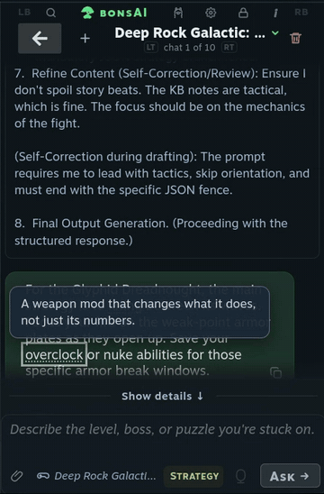

</details>

<details>
<summary><b>Screenshots</b> — <i>ask about what's on screen</i></summary>
<br>

Press the paperclip and pick **Close menu & take screenshot**. Reopen the menu, press the paperclip
again and pick **Attach recent screenshot**. This needs a model that can see pictures; the starter
model can.

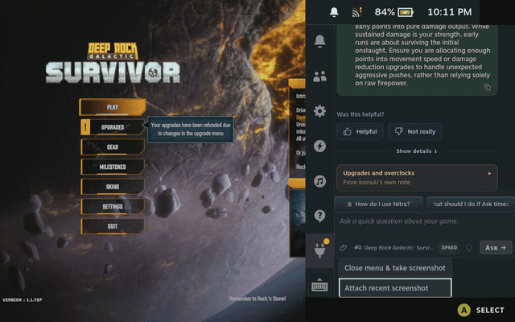

</details>

<details>
<summary><b>Search</b> — <i>chats, notes and Steam settings, no AI needed</i></summary>
<br>

The Search tab sits left of Main. Type "brightness" and jump straight to that Steam setting.

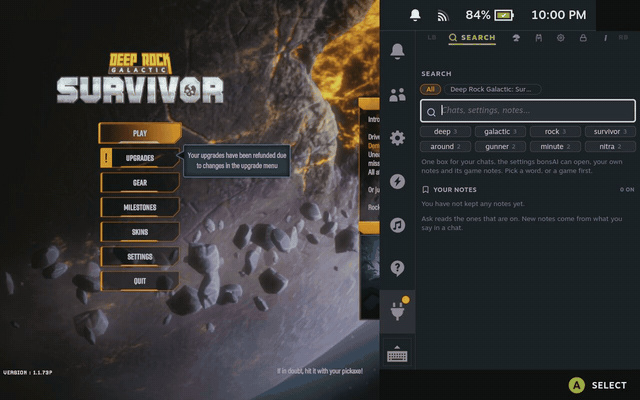

</details>

<details>
<summary><b>Keep playing</b> — <i>close the menu, a popup says when the answer's ready</i></summary>
<br>

The answer keeps going in the background. The **Reply ready** popup shows its first lines, and the
full answer waits in the chat.

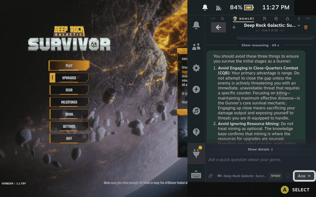

</details>

<details>
<summary><b>Saved chats</b> — <i>keep ten, flip between them with the triggers</i></summary>
<br>

At ten, **New chat** asks which one to delete first. Long chats are summed up so the older part
isn't forgotten.

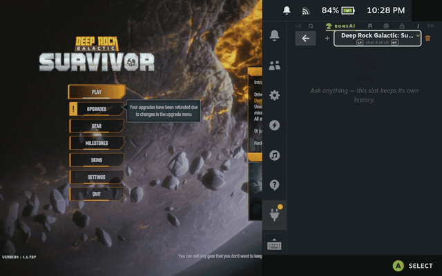

</details>

<details>
<summary><b>Talk instead of typing</b> — <i>speech becomes text on the Deck itself</i></summary>
<br>

Words appear as you talk. When you stop, bonsAI tidies the text in a couple of seconds, then
deletes the recording.

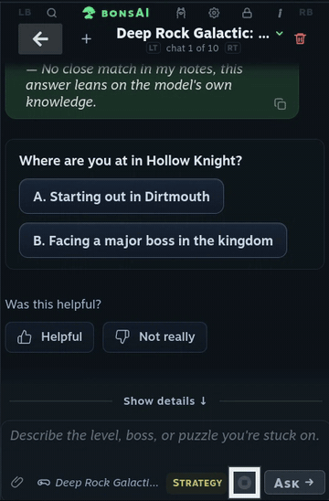

*With a computer voice played into the Deck.*

</details>

<details>
<summary><b>Show details</b> — <i>which model answered and which notes it used</i></summary>
<br>

Press **Show details** under any answer. Its **Session** tab holds the chat's history and **Sum up
this chat**.

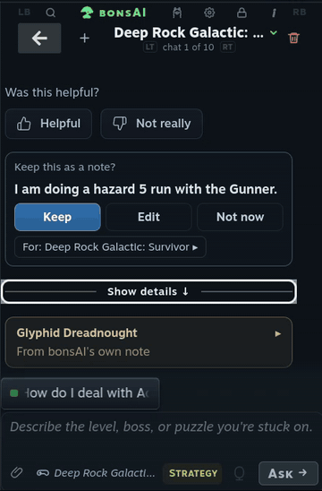

</details>

</dd></dl>

There's more: characters that change the tone of replies and a choice of AI models. The
**[user guide](docs/guide.md)** covers everything.

## Before you start

> [!WARNING]
> - **AI answers can be wrong.** Treat them as suggestions and check anything that matters.
> - **Running the AI on the Deck slows your game down**, because they share the same chip. A PC on
>   your home network is much faster.
> - **This is a new release.** A few problems are known; see
>   [known problems](docs/guide.md#known-problems).

## What you need

- A Steam Deck with **[Decky Loader](https://github.com/SteamDeckHomebrew/decky-loader)** installed.
  Decky is a free add-on that lets plugins like bonsAI into the Quick Access Menu.
- Somewhere to run the AI: the Deck itself, or a PC on your home network. bonsAI installs the
  program it needs, **Ollama**, on the Deck for you.
- About 5 GB free on the Deck for the starter set, if the AI runs on the Deck.

## Install

bonsAI isn't in Decky's plugin store, because the store doesn't accept plugins built on an AI
model. You install it from this page instead. It takes a few minutes.

### 1. Add bonsAI to Decky

1. Press **`...`**, open **Decky** (the plug icon), then the **gear** for Decky's settings.
2. Under **General**, switch on **Developer mode**. A **Developer** section appears.
3. In **Developer**, find **Install Plugin from URL**, paste this link and press **Install**:

   ```
   https://github.com/qd313/bonsAI/releases/latest/download/bonsAI.zip
   ```

4. bonsAI now shows in the Decky list. Open it.

### 2. Set up the AI

The first time bonsAI opens, two popups walk you through it:

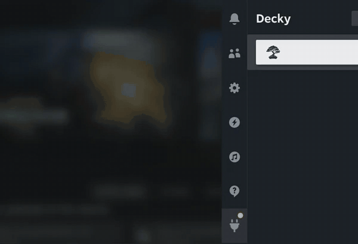

*Filmed in real time on a Steam Deck, with two pauses cut out.*

- **AI on the Deck** (works anywhere, slower in games): press **Install Ollama**, then **Turn on
  and download**. That gets Ollama and the starter models, about 4.6 GB.
- **AI on a PC at home** (much faster): install [Ollama](https://ollama.com/download) on the PC
  first. In the popup, switch off **Run AI on this Deck**, type the PC's address (like
  `192.168.1.20`) and press **Test connection**. The [guide](docs/guide.md#running-the-ai-on-a-pc)
  shows how to let the PC accept the connection.

Pressed **Not now**? The same choices are on the **Ollama** tab.

### 3. Ask something

Open the **Main** tab, pick a suggestion chip or type a question and press **Ask**.

**Then get the game notes.** On its own, the AI on the Deck knows little about any one game. Open
**Ollama → Knowledge base (offline)** and press **Download knowledge base**; it switches itself on. Answers
about a game it has notes for then use them, offline.

## Getting help

- The **[user guide](docs/guide.md)** explains every tab and setting.
- **[Troubleshooting](docs/troubleshooting.md)** covers network, screenshot and permission problems.
- Found a bug or have an idea? [Open an issue on GitHub](https://github.com/qd313/bonsAI/issues).
  Please say which bonsAI version you have (the small number beside the bonsAI title) and where the AI
  runs.

## Help build it

Want to help? [How to help](docs/how-to-help.md) covers reporting a bug and suggesting a game for
the knowledge library. To build it yourself, start with the [development guide](docs/development.md).

## License

- **The code** is [Apache-2.0](LICENSE). A little of it comes from the Decky plugin template, under
  its own BSD license; [NOTICE](NOTICE) has the details.
- **The game notes** and the **knowledge library** are CC BY-SA 4.0. Many notes are reworded from fan
  wikis, and each keeps a link to its source and that wiki's license; see
  [data/kb/NOTICE.md](data/kb/NOTICE.md).
- **Other people's code** that bonsAI uses keeps its own license. The download carries all of them in
  `dist/THIRD-PARTY-LICENSES.txt`.

## Buy me a beer

Supporting my Steam sale habit. Scan or tap:

[](https://paypal.me/quentind313)
