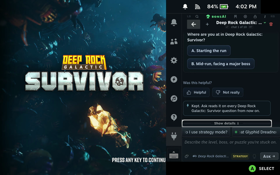
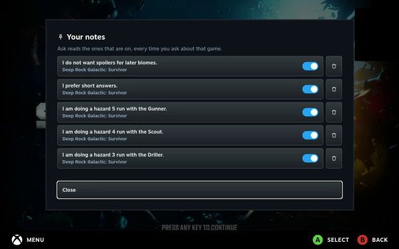
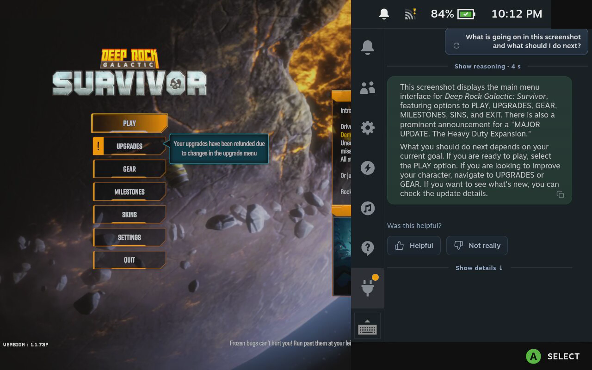
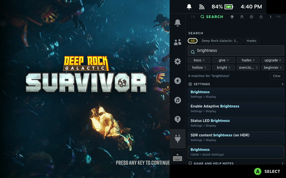
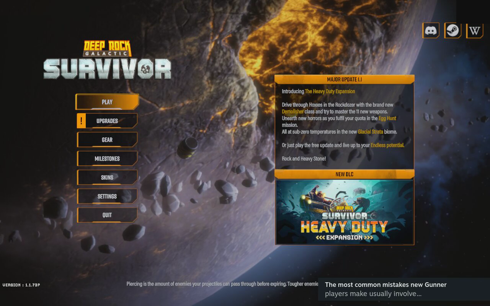
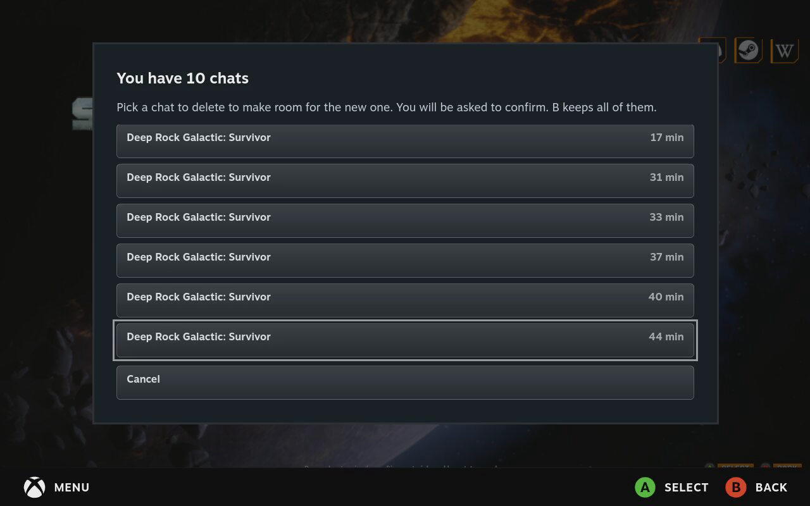
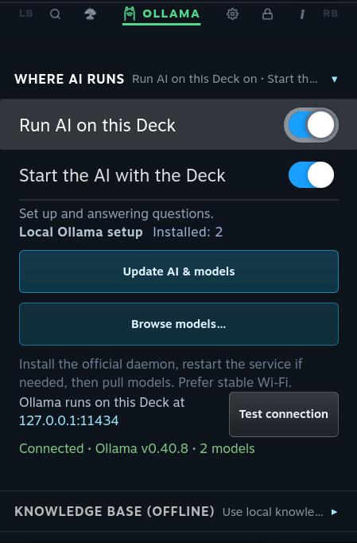

# bonsAI

[](https://github.com/qd313/bonsAI/releases/latest)
[](LICENSE)


**A helper for your Steam Deck that answers questions about your games, using an AI that runs on
your own Deck or your own PC.**

bonsAI lives in the Deck's **Quick Access Menu**, the panel the **`...`** button opens. Press it
mid-game, ask how to beat a boss or why the game stutters and keep playing.

<p align="center">
  
  &nbsp;
  
</p>

<!-- toc: written by scripts/docs_toc.py; do not hand-edit -->
**Contents**

- [Free, open and yours](#free-open-and-yours)
- [What it does](#what-it-does)
- [Before you start](#before-you-start)
- [What you need](#what-you-need)
- [Install](#install)
  - [1. Add bonsAI to Decky](#1-add-bonsai-to-decky)
  - [2. Allow downloads](#2-allow-downloads)
  - [3. Choose where the AI runs](#3-choose-where-the-ai-runs)
  - [4. Ask something](#4-ask-something)
- [Getting help](#getting-help)
- [Help build it](#help-build-it)
- [License](#license)
- [Buy me a beer](#buy-me-a-beer)
<!-- /toc -->

## Free, open and yours

> [!NOTE]
> bonsAI is free and open source. It runs on your own hardware, your privacy stays yours. No paid
> API, no data centers.
>
> - **Your questions stay on your hardware**, on your Deck, on your own PC or wherever you point it.
> - **No account, no cloud service, nothing collected.**
> - **Every line of code is here to read.**

<!-- This list matches the 0.6.0 security review (workshop:audit/security-review-0.6.0.md, 2026-09-28).
     Anything new that reaches the internet must be added here. -->
**What does reach the internet**, so you can check the claim instead of trusting it:

- **Installing Ollama** (the program that runs the AI) **and its models**: from **ollama.com**, which
  hands the program itself over from **GitHub**.
- **The knowledge library**: from **Hugging Face**, with **GitHub** as backup.
- **Voice input**: the speech engine from **GitHub**, the tools to build it from **Ubuntu's servers**
  and the speech model from **Hugging Face**.

Nothing downloads until you switch on **Internet downloads** on the Permissions tab, and bonsAI
tells you where each download comes from before it starts. Links inside answers open only when you
tap them.

## What it does

Every clip is filmed on a Steam Deck in real time. Most use an AI running on a PC on
the home network; the wiki-notes clip uses the AI on the Deck itself.

<details open>
<summary><h3>Ask about the game you're playing</h3><br>bonsAI knows which game is running. Ask about a boss, a level or a puzzle.</summary>
<br>

Open the menu mid-game and type, or pick a suggestion chip; the game's name goes in with your
question. Pick a mode on the question box: **Speed** for a quick reply, **Strategy** for coaching
like a strategy guide, **Expert** for the most effort and detail. Switch on **Thinking** and you can
watch the steps while it works. The answer streams in as it's written.

<!-- VIDEO: upload recordings/readme-cuts/ask-about-your-game-deck-full.mp4. Replace the next line with the link github.com gives when the file is dropped into the editor. -->


*A new chat, the three modes, a question, the thinking steps, the answer streaming in, Show
reasoning, a kept note and a branch pick. Filmed in real time, with the AI on a PC on the home
network.*

</details>

<details>
<summary><h3>Notes from the game's wiki</h3><br>Answers can use notes from community wikis, 38 games so far, and it works offline.</summary>
<br>


The knowledge library is a one-time download. When an answer uses a note, it says where the note
came from, and you can open the note under the answer.

*Filmed in real time, with the AI running on the Deck itself.*

<br clear="left">

</details>

<details>
<summary><h3>Your own notes</h3><br>Tell bonsAI what matters to you and it remembers.</summary>
<br>

Say something worth keeping, like "I do not want spoilers for later biomes", and a small card under
the answer offers to keep it, for this game or for every game. Later answers say **Read 1 of your
notes**; press that line to see your notes, switch one off or remove it.

<!-- VIDEO: upload recordings/readme-cuts/your-notes-deck-full.mp4. Replace the next line with the link github.com gives when the file is dropped into the editor. -->


*Filmed in real time, with the AI on a PC on the home network.*

</details>

<details>
<summary><h3>Spoilers stay hidden until you ask</h3><br>In Strategy mode, anything that looks like a spoiler is covered.</summary>
<br>


Press **A** on a cover to open it. This works on a best-effort basis and can miss things.

*Filmed in real time, with the AI on a PC on the home network.*

<br clear="right">

</details>

<details>
<summary><h3>"Where are you at?"</h3><br>Strategy can ask where you are in the game, then gives you a checklist of steps.</summary>
<br>


Tick off steps as you go. Your progress is saved on the Deck, for each game.

*Filmed in real time, with the AI on a PC on the home network.*

<br clear="left">

</details>

<details>
<summary><h3>Ask about a screenshot</h3><br>Take a screenshot and ask what's on screen, like a puzzle, a menu or an error message.</summary>
<br>

Press the paperclip on the question box and pick **Close menu & take screenshot**. Open the menu
again, press the paperclip, pick **Attach recent screenshot**, choose the picture and ask. This
needs a model that can see pictures; the starter model can.

<!-- VIDEO: upload recordings/readme-cuts/ask-about-a-screenshot-deck-full.mp4. Replace the next line with the link github.com gives when the file is dropped into the editor. -->


*Filmed in real time, with the AI on a PC on the home network.*

</details>

<details>
<summary><h3>Search your chats, settings and notes</h3><br>A Search tab to the left of Main finds things without any AI.</summary>
<br>

One find box looks through your chats, the game notes, your own notes and even Steam's own settings. Type
"brightness" and jump straight to that Steam setting.

<!-- VIDEO: upload recordings/readme-cuts/search-deck-full.mp4. Replace the next line with the link github.com gives when the file is dropped into the editor. -->


*Filmed in real time.*

</details>

<details>
<summary><h3>Close the menu, keep playing</h3><br>Close the menu while an answer is being written, and a popup tells you when it's ready.</summary>
<br>

The answer keeps going in the background. The **Reply ready** popup shows its first lines, and the
full answer waits in the chat.

<!-- VIDEO: upload recordings/readme-cuts/reply-ready-deck-full.mp4. Replace the next line with the link github.com gives when the file is dropped into the editor. -->


*Filmed in real time, with the AI on a PC on the home network.*

</details>

<details>
<summary><h3>Saved chats</h3><br>Keep up to ten chats and flip between them with the triggers.</summary>
<br>

At ten, **New chat** asks which chat to delete first, and nothing is deleted without the **Delete
chat** box. When a chat gets long, bonsAI sums up the older part so it isn't forgotten, and you can
ask it to sum up at any time.

<!-- VIDEO: upload recordings/readme-cuts/saved-chats-deck-full.mp4. Replace the next line with the link github.com gives when the file is dropped into the editor. -->


*Filmed in real time, with the AI on a PC on the home network.*

</details>

<details>
<summary><h3>Talk instead of typing</h3><br>Press the mic button and talk. Your speech becomes text on the Deck itself.</summary>
<br>


Words appear as you talk. When you stop, bonsAI reads the whole recording once more and tidies the
text, which takes a couple of seconds. The recording is deleted as soon as that's done.

*Filmed in real time, with a computer voice played into the Deck.*

<br clear="right">

</details>

<details>
<summary><h3>See how it answered</h3><br>Show details under any answer shows which model wrote it and which notes it used.</summary>
<br>


The **Session** tab inside it holds the chat's history and the **Sum up this chat** button.

*Filmed in real time, with the AI on a PC on the home network.*

<br clear="left">

</details>

There's more: characters that change the tone of replies and a choice of AI models. The
**[user guide](docs/guide.md)** covers everything.

## Before you start

> [!WARNING]
> - **AI answers can be wrong.** Treat them as suggestions and check anything that matters.
> - **Running the AI on the Deck slows your game down**, because they share the same chip. A PC on
>   your home network is much faster.
> - **This is a new release.** A few problems are known; see
>   [known problems](docs/guide.md#known-problems).

## What you need

- A Steam Deck with **[Decky Loader](https://github.com/SteamDeckHomebrew/decky-loader)** installed.
  Decky is a free add-on that lets plugins like bonsAI into the Quick Access Menu.
- Somewhere to run the AI: the Deck itself, or a PC on your home network. bonsAI installs the
  program it needs, **Ollama**, on the Deck for you.
- About 5 GB free on the Deck for the starter set, if the AI runs on the Deck.

## Install

bonsAI isn't in Decky's plugin store, because the store doesn't accept plugins built on an AI
model. You install it from this page instead. It takes a few minutes.

### 1. Add bonsAI to Decky

1. Press **`...`**, open **Decky** (the plug icon), then the **gear** for Decky's settings.
2. Under **General**, switch on **Developer mode**. A **Developer** section appears.
3. In **Developer**, find **Install Plugin from URL**, paste this link and press **Install**:

   ```
   https://github.com/qd313/bonsAI/releases/latest/download/bonsAI.zip
   ```

4. bonsAI now shows in the Decky list. Open it.

### 2. Allow downloads

Open the **Permissions** tab and switch on **Internet downloads**. Everything is off on a fresh
install, so nothing downloads without your say-so.

### 3. Choose where the AI runs



Open the **Ollama** tab. Pick one:

- **On the Deck** (works anywhere, slower in games): make sure **Run AI on this Deck** is on, then
  press **Install Ollama**. When it asks whether to add the starter set too, say yes. It brings the
  answer model (gemma4:e2b-it-qat), the note-search model (nomic-embed-text) and the speech models
  tiny.en and base.en, about 4.6 GB in all.
- **On a PC on your home network** (much faster): install [Ollama](https://ollama.com/download) on
  the PC and download a model there. Then type the PC's address into **PC address** on the Deck,
  something like `192.168.1.20` (bonsAI adds Ollama's usual port), and press **Test connection**. The
  [guide](docs/guide.md#running-the-ai-on-a-pc) shows how to let the PC accept the connection.

### 4. Ask something

Open the **Main** tab, pick a suggestion chip or type a question and press **Ask**.

**Optional:** for notes from game wikis, open **Ollama → Knowledge base (offline)**, switch on
**Use local knowledge base** and press **Download knowledge base**.

## Getting help

- The **[user guide](docs/guide.md)** explains every tab and setting.
- **[Troubleshooting](docs/troubleshooting.md)** covers network, screenshot and permission problems.
- Found a bug or have an idea? [Open an issue on GitHub](https://github.com/qd313/bonsAI/issues).
  Please say which bonsAI version you have (the small number beside the bonsAI title) and where the AI
  runs.

## Help build it

Want to help, or build it yourself? Start with the [development guide](docs/development.md).

## License

- **The code** is [Apache-2.0](LICENSE). A little of it comes from the Decky plugin template, under
  its own BSD license; [NOTICE](NOTICE) has the details.
- **The game notes** and the **knowledge library** are CC BY-SA 4.0. Many notes are reworded from fan
  wikis, and each keeps a link to its source and that wiki's license; see
  [data/kb/NOTICE.md](data/kb/NOTICE.md).
- **Other people's code** that bonsAI uses keeps its own license. The download carries all of them in
  `dist/THIRD-PARTY-LICENSES.txt`.

## Buy me a beer

Supporting my Steam sale habit. Scan or tap:

[](https://paypal.me/quentind313)
